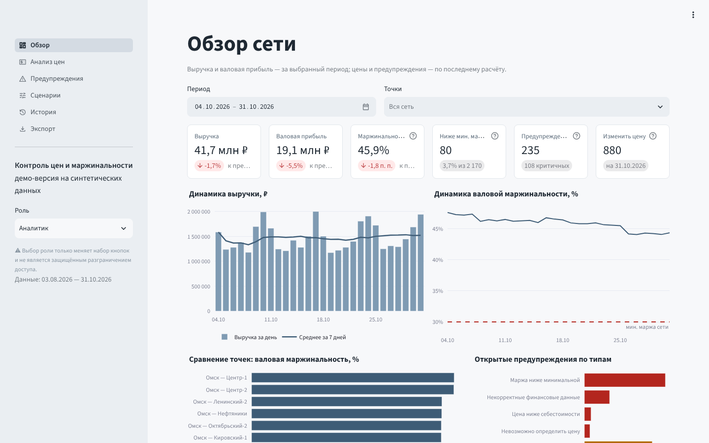
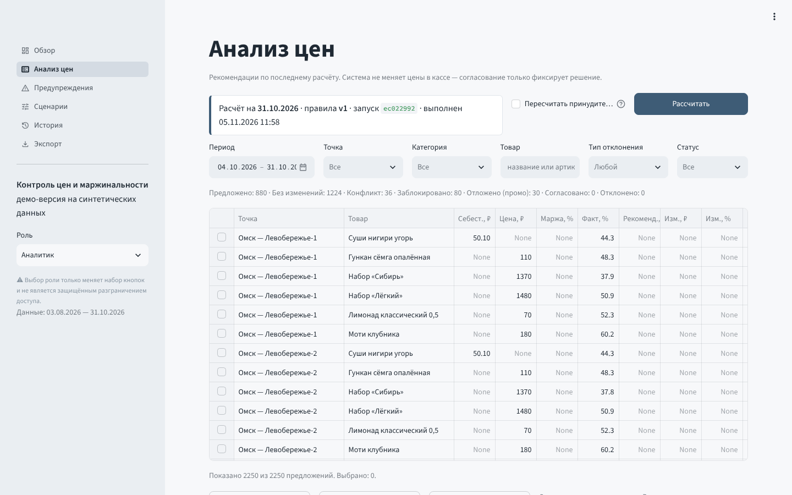
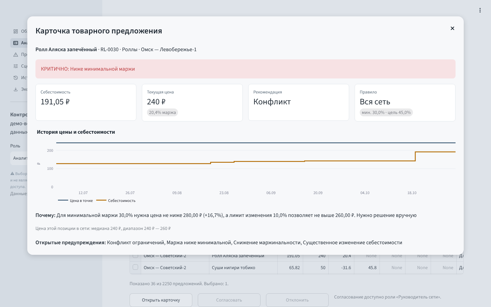
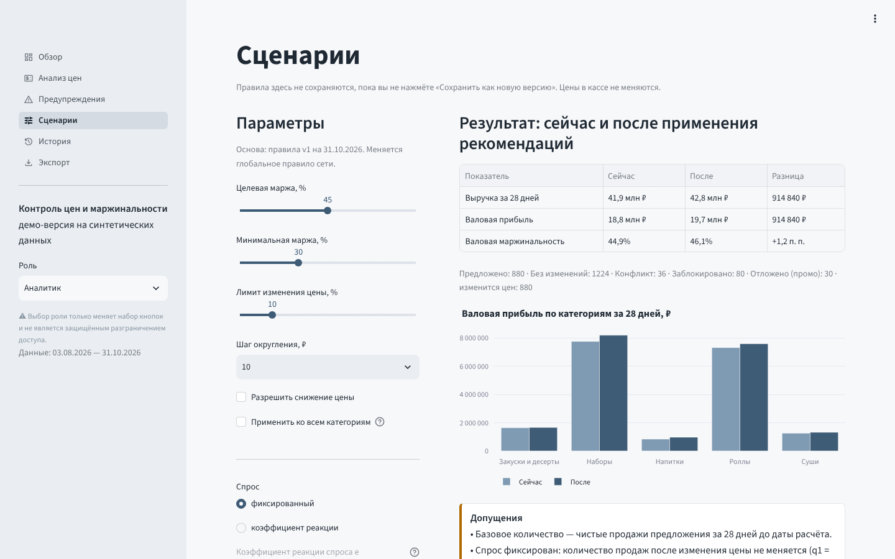
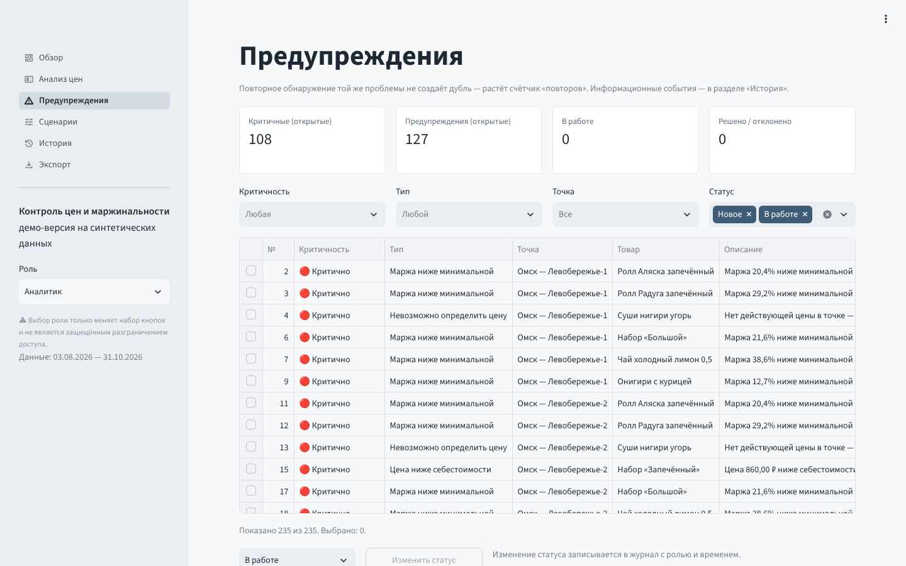
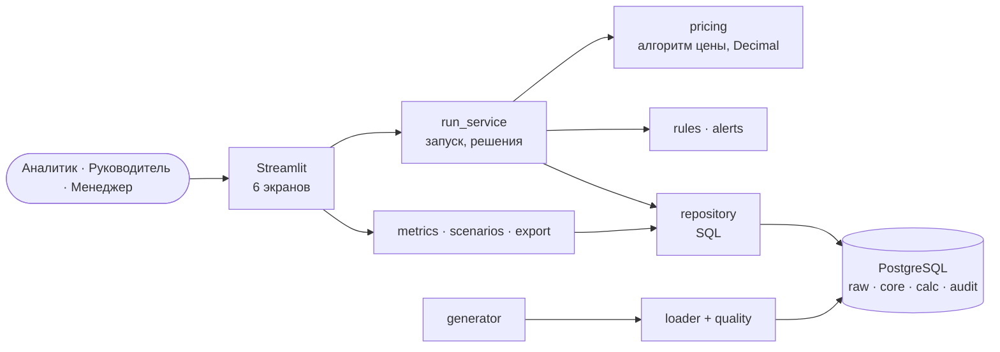

# Контроль цен и маржинальности торговой сети

Прототип системы поддержки решений по ценообразованию для сети точек формата «суши-маркет»: считает выручку и валовую маржу, предлагает рекомендуемые цены по прозрачным правилам, объясняет каждую рекомендацию и находит нарушения бизнес-правил и ошибки в данных.

> **Все данные синтетические.** Они созданы генератором с фиксированным seed и не являются показателями какой-либо реальной компании. Названия точек и товаров вымышлены. Проект учебно-практический и не связан с инфраструктурой какой-либо компании.



## 1. Бизнес-проблема

Себестоимость ингредиентов меняется часто, а цены на витрине пересматривают редко и вручную. Часть позиций незаметно теряет маржу, у одного товара в разных точках разные цены без понятной причины, а ошибки в исходных данных (нулевая себестоимость, пропавшая цена) искажают отчёты.

## 2. Цели

- Видеть, где теряется маржа: по сети, точкам, категориям, товарам.
- Получать рекомендуемую цену с понятной причиной и версией правил.
- Не пропускать ошибки данных и нарушения правил.
- Оценивать эффект изменения цен до решения, с явными допущениями.
- Получать один и тот же результат при повторном расчёте на тех же данных.

Система **не меняет цены в кассе**: согласование только фиксирует решение.

## 3. Функциональность

| Экран | Что делает |
|---|---|
| Обзор | 6 карточек показателей, динамика выручки и маржинальности, сравнение точек, предупреждения по типам |
| Анализ цен | Рекомендации последнего расчёта, 6 фильтров, запуск расчёта, согласование/отклонение, карточка предложения |
| Предупреждения | Критичные и обычные предупреждения без дублей, смена статуса, итоги проверок качества |
| Сценарии | «Что если» по целевой марже, минимуму, лимиту, шагу, спросу; сохранение как новой версии правил |
| История | Запуски, журнал событий, версии правил, решения по рекомендациям |
| Экспорт | CSV и Excel с сохранением числовых типов и дат |

Переключатель роли (аналитик, руководитель сети, операционный менеджер) только меняет набор кнопок. **Это не защищённое разграничение доступа.**

| Анализ цен | Карточка предложения |
|---|---|
|  |  |
| **Сценарии** | **Предупреждения** |
|  |  |

## 4. Архитектура



Главные решения: данные идут по слоям `raw → core → calc → audit`; суммы по 316 тыс. строк продаж считает PostgreSQL (`NUMERIC`), ветвящийся алгоритм цены — Python на `Decimal`; модули расчёта не зависят от Streamlit. Полный набор диаграмм (контекстная, компонентная, бизнес-процесс, последовательность) и 11 архитектурных решений — в [docs/05_architecture.md](docs/05_architecture.md).

## 5. Модель данных

23 таблицы (из них 3 «сырые») и 3 представления в четырёх схемах. ER-диаграмма и словарь данных — [docs/03_data_model.md](docs/03_data_model.md). Ключевые приёмы:

- выручка строки — вычисляемое поле с правилом знака (продажа «+», возврат «−», отмена 0);
- себестоимость продажи берётся по версии, действовавшей на дату продажи;
- защита от повторной загрузки — уникальный хэш строки;
- использованный набор правил заблокирован триггером, журнал событий только дополняется.

## 6. Технологии

Python 3.12 · PostgreSQL 16 · psycopg 3 · Pandas · NumPy · Decimal/NUMERIC · Streamlit · Plotly · openpyxl · Pytest · Ruff · uv · Docker Compose · GitHub Actions · Mermaid.

## 7. Структура проекта

```
├── app/                     веб-интерфейс (main.py, views/, components/)
├── src/pmc/                 логика: pricing, rules, metrics, alerts, scenarios, quality,
│   │                        run_service, repository, loader, export, migrate, cli
│   └── generator/           справочники (общие с проектом №2), факты, заведомые ошибки
├── migrations/              SQL-миграции 001–004
├── tests/                   unit/ integration/ ui/
├── docs/                    проектная документация, скриншоты, результаты тестов
├── compose.yaml, Dockerfile, .env.example
└── .github/workflows/ci.yml
```

## 8. Запуск

**Через Docker** (нужны Docker и Docker Compose):

```bash
cp .env.example .env
docker compose up --build
# открыть http://localhost:8501
```

Контейнер `init` применяет миграции, генерирует и загружает демо-данные и выполняет первый расчёт; приложение стартует после его успешного завершения.

**Без Docker** (нужны PostgreSQL 16 и [uv](https://docs.astral.sh/uv/)):

```bash
cp .env.example .env            # поправьте DATABASE_URL под свою базу
uv sync
uv run pmc init-demo            # миграции + демо-данные + первый расчёт
uv run streamlit run app/main.py
```

Другие команды: `pmc check-db`, `pmc migrate`, `pmc generate --out data/` (демо-данные в CSV), `pmc load --reset`, `pmc run-pricing [--force]`.

## 9. Пример расчёта

Правило сети: целевая маржа 45%, минимальная 30%, лимит изменения 10%, шаг 10 ₽, округление вверх.

| Шаг | «Ролл Аляска», Омск — Левобережье-1 |
|---|---|
| Себестоимость / текущая цена | 179,67 ₽ / 280 ₽ (маржа 35,8%) |
| Базовая цена = 179,67 / (1 − 0,45) | 326,67 ₽ → округление 330 ₽ |
| Лимит: 280 × 1,10 = 308 ₽ | 330 > 308 → 300 ₽ (вниз до шага в пределах лимита) |
| Маржа при 300 ₽ | 40,1% ≥ 30% — ограничение соблюдено |
| Итог | **Предложено 300 ₽ (+7,1%)**: себестоимость выросла с 174,99 до 179,67 ₽; целевая маржа будет достигнута при следующих пересмотрах |

**Конфликт правил** — «Ролл Аляска запечённый»: себестоимость 191,05 ₽ (+35% с 19.10), цена 240 ₽. Для минимальной маржи нужно не меньше 280 ₽ (+16,7%), лимит позволяет не больше 260 ₽. Система **не подбирает цену сама**: статус «Конфликт», решение принимает руководитель с ценой вручную.

**Найденное отклонение**: «Ролл Аляска запечённый» — себестоимость 141,52 → 191,05 ₽ (+35%) с 19.10.2026 → предупреждение «Существенное изменение себестоимости».

Методика всех метрик и правила для нулевых значений — [docs/04_metrics_and_pricing.md](docs/04_metrics_and_pricing.md).

## 10. Примеры SQL

Себестоимость на дату продажи — интервалы действия версий через оконную функцию:

```sql
CREATE VIEW core.v_product_cost_range AS
SELECT product_id, valid_from,
       COALESCE(LEAD(valid_from) OVER w - 1, DATE 'infinity') AS valid_to,
       unit_cost
FROM core.product_cost
WINDOW w AS (PARTITION BY product_id ORDER BY valid_from);
```

Выручка, валовая прибыль и строки без себестоимости по точкам:

```sql
SELECT f.store_id, s.name,
       sum(f.net_revenue)                                         AS revenue,
       sum(f.net_revenue) FILTER (WHERE f.unit_cost IS NOT NULL)
         - sum(f.net_cogs)                                        AS gross_profit,
       count(*) FILTER (WHERE f.unit_cost IS NULL AND NOT f.is_cancelled) AS lines_no_cost
FROM core.v_sale_fact f JOIN core.store s USING (store_id)
WHERE f.sale_date BETWEEN '2026-10-04' AND '2026-10-31'
GROUP BY f.store_id, s.name;
```

Предупреждение без дублей при повторном запуске:

```sql
INSERT INTO calc.alert (alert_code, severity, store_id, product_id, run_id, description, dedup_key)
VALUES (...)
ON CONFLICT (dedup_key) WHERE status IN ('NEW', 'IN_PROGRESS')
DO UPDATE SET last_seen_at = now(), occurrences = calc.alert.occurrences + 1;
```

## 11. Тестирование

99 автоматических тестов: модульные (формулы, алгоритм цены, проверки качества, сценарии, алерты, экспорт, генератор), интеграционные с PostgreSQL (ограничения БД, идемпотентность, история, согласованность SQL и Python до копейки, поиск каждой заложенной ошибки) и проверки всех 6 экранов для каждой из 3 ролей через Streamlit AppTest.

```bash
uv run pytest -m "not integration and not ui"          # без базы
TEST_DATABASE_URL=postgresql://…/pmc_test uv run pytest  # всё; имя базы должно заканчиваться на _test
docker compose run --rm app pytest                      # внутри Docker
```

Фактический результат последнего запуска (99 passed, покрытие 95%) — [docs/test_results.txt](docs/test_results.txt). Связь требований с критериями приёмки и тестами — [docs/02_requirements.md](docs/02_requirements.md). Что проверено и что нет — [docs/07_implementation_report.md](docs/07_implementation_report.md).

## 12. Ограничения

- Данные синтетические; закономерности заданы генератором и ничего не говорят о реальном бизнесе.
- Себестоимость единая для всей сети; операционные расходы (аренда, зарплата) не учитываются — только валовая маржа.
- Эластичность спроса не оценивается: сценарий считает либо фиксированный спрос, либо коэффициент, заданный вручную.
- Нет авторизации; роли — только переключатель интерфейса.
- Нет интеграции с кассой и учётной системой; цены не отправляются никуда.
- Пустые числовые ячейки таблиц Streamlit подписывает как «None».

## 13. Возможности развития

Оценка эластичности по истории продаж и промо; себестоимость по точкам; психологические окончания цен (…9 ₽); авторизация и права; загрузка данных из учётной системы по расписанию; уведомления о критичных предупреждениях.

## 14. Роль автора

Учебно-практический проект бизнес-аналитика. Автор сформулировал бизнес-задачу, требования, бизнес-правила и критерии приёмки, проверял результаты расчётов и интерфейс. Код, тесты и инфраструктура разработаны с помощью ИИ-ассистента по этим требованиям; проект используется автором для изучения Python, SQL и PostgreSQL и не является подтверждением коммерческого опыта разработки.

## Документация

| Документ | Содержание |
|---|---|
| [01 — паспорт и границы](docs/01_vision_and_scope.md) | Контекст, цели, стейкхолдеры, допущения, риски |
| [02 — требования](docs/02_requirements.md) | BR, FR, NFR, сценарии, критерии приёмки, тест-кейсы |
| [03 — модель данных](docs/03_data_model.md) | ER-диаграмма, словарь данных, ошибки в демо-данных |
| [04 — метрики и алгоритм](docs/04_metrics_and_pricing.md) | Методика метрик, алгоритм цены, предупреждения, сценарии |
| [05 — архитектура](docs/05_architecture.md) | ADR, 4 диаграммы, инфраструктура |
| [06 — макеты](docs/06_ui_mockups.md) | 5 макетов экранов |
| [07 — отчёт о реализации](docs/07_implementation_report.md) | Статус требований, демо-сценарий, что не проверено |
