# 03. Модель данных

## 1. Слои (схемы PostgreSQL)

| Схема | Назначение | Строгость |
|---|---|---|
| `raw` | Данные «как пришли» из генератора (в реальности — из учётной системы). Типы мягкие, ограничений почти нет — сюда специально попадают ошибочные записи | Низкая |
| `core` | Проверенные справочники и факты. Все ограничения целостности | Высокая |
| `calc` | Правила, запуски расчёта, рекомендации, предупреждения | Высокая |
| `audit` | Журнал событий, проблемы качества данных, применённые миграции | Высокая |

**Простыми словами:** сначала складываем данные в «приёмную» (`raw`), проверяем, хорошее переносим в «основной склад» (`core`), плохое записываем в журнал проблем. Так ошибки данных не ломают расчёты, но и не теряются бесследно.

## 2. ER-диаграмма

```mermaid
erDiagram
    STORE ||--o{ STORE_PRICE : "имеет цены"
    STORE ||--o{ SALE_LINE : "продаёт"
    STORE ||--o{ STOCK_DAILY : "хранит"
    STORE ||--o{ WRITE_OFF : "списывает"
    STORE ||--o{ STORE_CALENDAR : "работает"
    CATEGORY ||--o{ CATEGORY : "родитель"
    CATEGORY ||--o{ PRODUCT : "включает"
    PRODUCT ||--o{ PRODUCT_COST : "версии себестоимости"
    PRODUCT ||--o{ STORE_PRICE : "цена в точке"
    PRODUCT ||--o{ SALE_LINE : "продан"
    PRODUCT ||--o{ STOCK_DAILY : "остаток"
    PRODUCT ||--o{ WRITE_OFF : "списан"
    PROMO ||--o{ PROMO_ITEM : "состав"
    PRODUCT ||--o{ PROMO_ITEM : "участвует"
    STORE |o--o{ PROMO_ITEM : "точка (пусто = вся сеть)"
    PROMO |o--o{ SALE_LINE : "применена"
    RULE_SET ||--|{ PRICING_RULE : "содержит"
    RULE_SET ||--o{ PRICING_RUN : "использован"
    PRICING_RUN ||--o{ PRICE_RECOMMENDATION : "создаёт"
    STORE ||--o{ PRICE_RECOMMENDATION : "для точки"
    PRODUCT ||--o{ PRICE_RECOMMENDATION : "для товара"
    PRICING_RULE ||--o{ PRICE_RECOMMENDATION : "применено"
    PRICING_RUN |o--o{ ALERT : "обнаружил"
    STORE |o--o{ ALERT : "касается"
    PRODUCT |o--o{ ALERT : "касается"

    STORE {
        smallint store_id PK
        varchar code UK "ST01..ST15"
        varchar name
        varchar region
        varchar city
        boolean is_active
        date opened_on
    }
    CATEGORY {
        smallint category_id PK
        varchar name UK
        smallint parent_id FK
    }
    PRODUCT {
        int product_id PK
        varchar sku UK
        varchar name
        smallint category_id FK
        varchar sale_unit "шт, порция, набор"
        boolean is_fresh "срок годности 1 день"
        boolean is_active
    }
    PRODUCT_COST {
        bigint cost_id PK
        int product_id FK
        date valid_from
        numeric unit_cost "12,4; > 0"
        varchar source
        int calc_version
    }
    STORE_PRICE {
        bigint price_id PK
        smallint store_id FK
        int product_id FK
        date valid_from
        numeric price "12,2; > 0"
    }
    SALE_LINE {
        bigint sale_line_id PK
        bigint order_id
        timestamptz sold_at
        date sale_date "дата по Asia/Omsk"
        smallint store_id FK
        int product_id FK
        numeric quantity "> 0"
        numeric unit_price
        numeric discount_amount ">= 0"
        varchar operation_type "sale | return"
        boolean is_cancelled
        int promo_id FK
        numeric net_quantity "вычисляемое"
        numeric net_revenue "вычисляемое"
        varchar source_row_hash UK
    }
    STOCK_DAILY {
        smallint store_id PK,FK
        int product_id PK,FK
        date stock_date PK
        numeric opening_qty
        numeric produced_qty
        numeric sold_qty
        numeric written_off_qty
        numeric closing_qty
        boolean is_available "товар был в продаже"
    }
    STORE_CALENDAR {
        smallint store_id PK,FK
        date calendar_date PK
        boolean is_open
        varchar note
    }
    WRITE_OFF {
        bigint write_off_id PK
        smallint store_id FK
        int product_id FK
        date write_off_date
        numeric quantity
        varchar reason "expired, damaged, return, other"
    }
    PROMO {
        int promo_id PK
        varchar name
        date date_from
        date date_to
        numeric discount_pct
    }
    PROMO_ITEM {
        int promo_id PK,FK
        int product_id PK,FK
        smallint store_id FK "NULL = вся сеть"
    }
    RULE_SET {
        int rule_set_id PK
        int version UK
        date effective_from
        boolean is_locked
        varchar created_by
        text comment
    }
    PRICING_RULE {
        int rule_id PK
        int rule_set_id FK
        varchar scope_type "global, store, category, product"
        int scope_id
        numeric target_margin
        numeric min_margin
        numeric max_change
        numeric rounding_step
        varchar rounding_mode
        boolean allow_decrease
    }
    PRICING_RUN {
        uuid run_id PK
        timestamptz started_at
        timestamptz finished_at
        date as_of_date
        int rule_set_id FK
        varchar idempotency_key UK
        varchar status "running, done, failed"
        varchar triggered_by
        int offers_total
    }
    PRICE_RECOMMENDATION {
        bigint recommendation_id PK
        uuid run_id FK
        smallint store_id FK
        int product_id FK
        int rule_id FK
        numeric unit_cost
        numeric current_price
        numeric base_price
        numeric recommended_price
        numeric change_abs
        numeric change_pct
        varchar status
        varchar reason_code
        text reason_text
        jsonb details
        varchar decided_by
        timestamptz decided_at
    }
    ALERT {
        bigint alert_id PK
        varchar alert_code
        varchar severity "CRIT, WARN"
        smallint store_id FK
        int product_id FK
        uuid run_id FK
        text description
        varchar dedup_key
        timestamptz first_seen_at
        timestamptz last_seen_at
        int occurrences
        varchar status "NEW, IN_PROGRESS, RESOLVED, DISMISSED"
    }
```

Таблицы `audit.event_log`, `audit.dq_issue`, `audit.load_batch`, `audit.schema_migration` и `raw.*` на диаграмме не показаны, чтобы она оставалась читаемой; они описаны ниже.

**Как читать схему:** `||--o{` — «один ко многим, может быть ноль»; `||--|{` — «один к одному или многим, минимум один» (в наборе правил обязательно есть хотя бы одно правило); `|o--o{` — связь необязательна (у предупреждения может не быть товара, если оно про точку целиком).

## 3. Словарь данных (ключевые поля и ограничения)

### core.store
| Поле | Тип | Ограничения | Описание |
|---|---|---|---|
| store_id | smallint | PK | Фиксирован (1–15), одинаков в обоих проектах |
| code | varchar(8) | UNIQUE, NOT NULL | ST01…ST15 |
| name | varchar(100) | NOT NULL | Условное название |
| region, city | varchar(100) | NOT NULL | Омская область; Омск и 2 районных центра |
| is_active | boolean | NOT NULL DEFAULT true | Закрытая точка остаётся в истории |

### core.product
| Поле | Тип | Ограничения | Описание |
|---|---|---|---|
| product_id | int | PK | Фиксирован (1–150) |
| sku | varchar(16) | UNIQUE, NOT NULL | Артикул вида `RL-0001` |
| category_id | smallint | FK → category, NOT NULL | |
| sale_unit | varchar(16) | CHECK IN ('шт','порция','набор','бутылка') | |

### core.product_cost
- `UNIQUE (product_id, valid_from)` — на одну дату одна версия.
- `CHECK (unit_cost > 0)` — в `core` нулевая и отрицательная себестоимость невозможны; такие строки остаются в `raw` и попадают в `audit.dq_issue`.
- Индекс `(product_id, valid_from DESC)` — для поиска версии «на дату».

### core.store_price
- `UNIQUE (store_id, product_id, valid_from)`, `CHECK (price > 0)`.
- Индекс `(store_id, product_id, valid_from DESC)`.

### core.sale_line
- `CHECK (quantity > 0)`, `CHECK (unit_price >= 0)`, `CHECK (discount_amount >= 0 AND discount_amount <= quantity * unit_price)`, `CHECK (operation_type IN ('sale','return'))`.
- `net_revenue NUMERIC(12,2) GENERATED ALWAYS AS (CASE WHEN is_cancelled THEN 0 WHEN operation_type = 'return' THEN -(quantity*unit_price - discount_amount) ELSE quantity*unit_price - discount_amount END) STORED` — правило знака зашито в БД, его нельзя «забыть» в запросе.
- `source_row_hash` UNIQUE — защита от повторной загрузки той же строки (дубли).
- `order_id` — номер чека; нужен проекту №2 для среднего чека.
- Индексы: `(store_id, sold_at)`, `(product_id, sold_at)`. Секционирование не нужно: ≈ 400 тыс. строк.

### calc.pricing_rule
- `CHECK (target_margin >= 0 AND target_margin < 1)`
- `CHECK (min_margin >= 0 AND min_margin <= target_margin)`
- `CHECK (max_change > 0 AND max_change <= 1)`
- `CHECK (rounding_step > 0)`, `CHECK (rounding_mode IN ('up','nearest','down'))`
- `CHECK ((scope_type = 'global') = (scope_id IS NULL))`
- `UNIQUE (rule_set_id, scope_type, scope_id)` с `NULLS NOT DISTINCT` (PostgreSQL 15+), чтобы в наборе было одно глобальное правило.
- Изменение набора с `is_locked = true` запрещено триггером.

### calc.price_recommendation
- `UNIQUE (run_id, store_id, product_id)` — в одном запуске одна рекомендация на предложение.
- `CHECK (status IN ('PROPOSED','NO_CHANGE','CONFLICT','BLOCKED','ON_HOLD','APPROVED','REJECTED','SUPERSEDED'))`
- `CHECK (status NOT IN ('PROPOSED','APPROVED') OR recommended_price IS NOT NULL)`
- Индексы: `(status)`, `(store_id, product_id)`.

### calc.alert
- `CHECK (severity IN ('CRIT','WARN'))` — INFO-события живут в `audit.event_log`.
- `CREATE UNIQUE INDEX ux_alert_open ON calc.alert (dedup_key) WHERE status IN ('NEW','IN_PROGRESS')`.
- Индекс `(severity, status, first_seen_at DESC)`.

### audit.event_log
`event_id`, `event_at`, `event_type` (RUN_STARTED, RUN_COMPLETED, RULE_SET_CREATED, RECOMMENDATION_APPROVED, …), `actor_role`, `run_id`, `payload jsonb`. Только вставка, без обновлений.

### audit.dq_issue
`issue_id`, `checked_at`, `source_table`, `source_key`, `check_code` (DUPLICATE, NON_POSITIVE_COST, MISSING_PRICE, FK_VIOLATION, OUT_OF_RANGE, …), `severity`, `details jsonb`.

### raw.*
`raw.sale_line`, `raw.product_cost`, `raw.store_price` — те же поля, но все `NULL`-able, без `CHECK` и FK, плюс `loaded_at` и `batch_id`.

### Дополнения, появившиеся при реализации

| Объект | Зачем |
|---|---|
| `core.product.is_fresh` | Свежая продукция живёт один день: остаток на конец дня списывается. Нужен генератору и проекту №2 |
| `core.sale_line.sale_date` | Дата по местному времени точки хранится явно: так соединения «на дату» не зависят от часового пояса сервера |
| `core.sale_line.net_quantity` | Вычисляемое количество со знаком (как `net_revenue`) |
| `core.stock_daily.is_available` | Товар был в продаже в этот день. Дни без продажи не означают нулевой спрос (важно для XYZ в проекте №2) |
| `core.store_calendar` | Санитарные дни: в такие дни точка не работает |
| `core.v_product_cost_range`, `core.v_store_price_range`, `core.v_sale_fact` | Представления с интервалами действия версий и фактом продаж с себестоимостью на дату продажи |
| `audit.load_batch` | Пакет загрузки: сколько строк пришло в `raw`, сколько попало в `core`, сколько проблем |
| `calc.pricing_run.is_forced`, `error_text` | Принудительный пересчёт и текст ошибки неудачного запуска |
| Частичный индекс `ux_run_idempotency` | Не больше одного обычного завершённого запуска на ключ идемпотентности |
| Триггеры `trg_pricing_rule_locked`, `trg_event_log_append_only` | Использованные правила нельзя менять; журнал событий нельзя править и удалять |

## 4. Объём демо-данных (фактический, seed 20261105)

| Таблица | Строк в `raw` | Строк в `core` |
|---|---|---|
| store / category / product | — | 15 / 5 / 150 |
| sale_line | 316 208 | 316 140 |
| product_cost | 609 | 604 |
| store_price | 2 835 | 2 835 |
| stock_daily | — | 202 500 |
| write_off | — | ≈ 114 тыс. |
| Проблем качества данных | — | 78 |

## 4а. Объём демо-данных (первоначальная оценка)

| Таблица | Строк |
|---|---|
| store / category / product | 15 / 5 / 150 |
| store_price | ≈ 2 250 исходных + ≈ 600 изменений |
| product_cost | ≈ 150 × 4 версии ≈ 600 |
| sale_line | ≈ 15 × 90 × 120 чеков × 2,3 строки ≈ 370–420 тыс. |
| stock_daily | 15 × 150 × 90 = 202 500 |
| write_off | ≈ 20–30 тыс. |

## 5. Заведомые ошибки в генераторе

Каждая ошибка помечается в отдельном файле-манифесте генератора, чтобы тест мог проверить, что проверки нашли **все** заложенные ошибки:

| Код | Что закладываем | Сколько |
|---|---|---|
| E-01 | Полный дубль строки продажи | 50 |
| E-02 | Себестоимость = 0 | 3 версии |
| E-03 | Отрицательная себестоимость | 2 версии |
| E-04 | Предложение без цены | 5 пар точка×товар |
| E-05 | Цена ниже себестоимости | 6 предложений |
| E-06 | Скачок себестоимости > 30% | 4 товара |
| E-07 | Продажа несуществующего товара | 10 строк |
| E-08 | Скидка больше суммы строки | 8 строк |
| E-09 | Цена в точке на 40% выше медианы сети | 5 предложений |

## 6. Совместимость с проектом №2

- Идентификаторы `store_id`, `product_id`, `category_id`, `sku` фиксированы и формируются детерминированно (не из генератора случайных чисел).
- Генератор справочников — один и тот же модуль в обоих репозиториях; seed `20261105`.
- `stock_daily`, `write_off`, `order_id` заводятся уже в проекте №1, хотя в основном нужны проекту №2.
