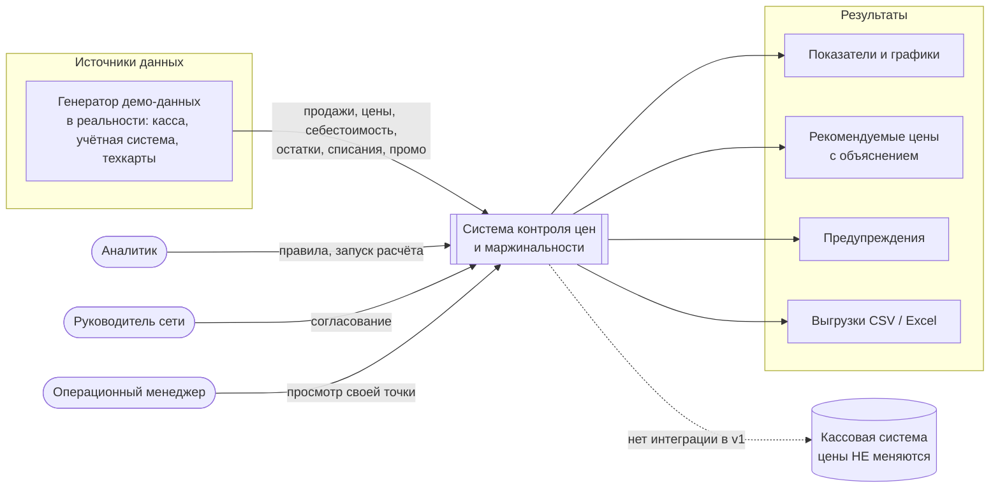
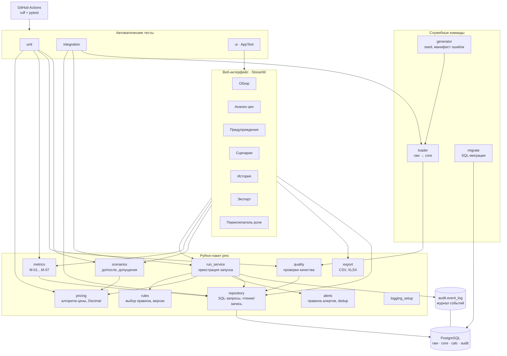
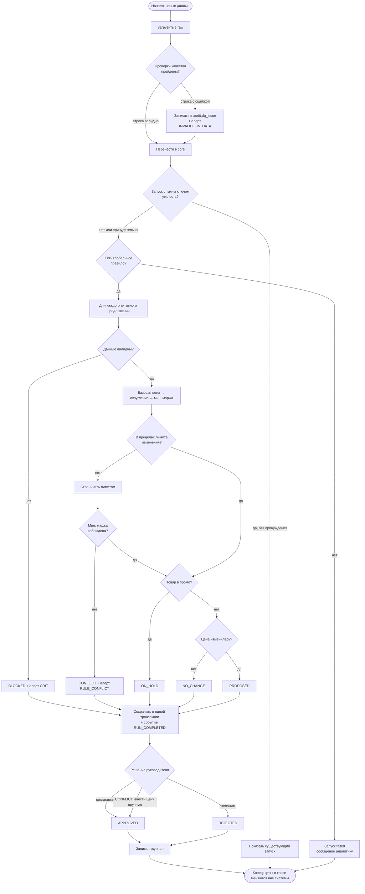
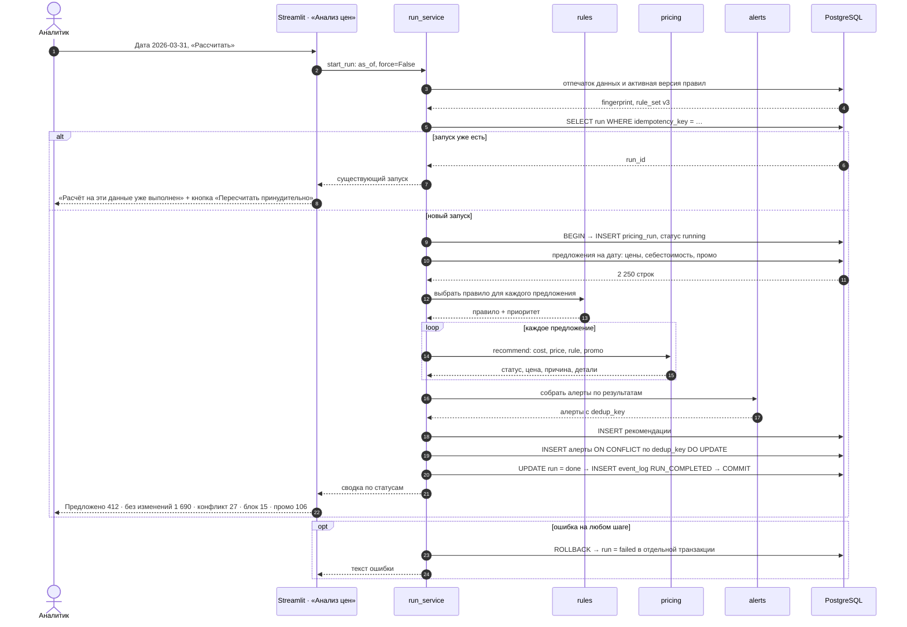

# 05. Архитектура приложения

## 1. Архитектурные решения (ADR)

| ID | Решение | Почему | Чем платим |
|---|---|---|---|
| ADR-01 | Слои `raw → core → calc → audit` в одной БД | Ошибочные данные не ломают расчёты и не теряются; легко объяснить на собеседовании | Дублирование структур `raw` и `core` |
| ADR-02 | Агрегаты по продажам считаются в SQL, расчёт цены по предложению — в Python на `Decimal` | SQL быстро и точно (`NUMERIC`) суммирует 400 тыс. строк; алгоритм цены с ветвлениями проще читать и тестировать в Python | Логика метрик есть в SQL, поэтому нужен тест согласованности (TC-15) |
| ADR-03 | Драйвер `psycopg` 3 без ORM | Меньше «магии», автор видит настоящий SQL; одна зависимость вместо SQLAlchemy + Alembic | Миграции пишем сами |
| ADR-04 | Миграции — пронумерованные `.sql` файлы и раннер на ~60 строк с таблицей `audit.schema_migration` и контрольной суммой | ТЗ допускает «строго управляемую инициализацию»; понятно без изучения Alembic | Нет автогенерации и отката (для прототипа не нужно) |
| ADR-05 | Модули расчёта не импортируют Streamlit | Тестируются Pytest без интерфейса (требование ТЗ §28) | — |
| ADR-06 | Зависимости через `uv` и `uv.lock` | Точная фиксация версий в связке с `pyproject.toml`, быстрая установка в Docker и CI | Ещё один инструмент; альтернатива — `pip-tools` |
| ADR-07 | Интеграционные тесты против реального PostgreSQL (сервис в Compose и в GitHub Actions) | SQLite не поддерживает `NUMERIC`, частичные индексы и `ON CONFLICT` так же | Тесты медленнее модульных; помечены `@pytest.mark.integration` |
| ADR-08 | INFO-события в журнал, а не в таблицу алертов | 2 250 «цена рассчитана» в списке предупреждений сделали бы его бесполезным | Два места для событий |
| ADR-09 | Расчёт запуска — одна транзакция | Нет «половинчатых» запусков при сбое | Блокировка на время расчёта (секунды) |
| ADR-10 | Роли — переключатель в верхней строке страницы (боковая панель — только разделы) | ТЗ разрешает; честная пометка «не защита» | Нет реального контроля доступа |
| ADR-11 | `openpyxl` для XLSX | Нужен Pandas для записи Excel; это единственная дополнительная библиотека вне стека ТЗ | +1 зависимость |

## 2. Контекстная диаграмма



**Простыми словами:** три типа пользователей работают с одним приложением. Данные приходят из генератора (в реальной жизни это была бы касса и учётная система). На выходе — показатели, рекомендации, предупреждения и файлы. Пунктир к кассе подчёркивает: система ничего в кассу не отправляет.

## 3. Компонентная архитектура



**Простыми словами:** интерфейс только показывает данные и передаёт команды. Вся логика — в пакете `pmc` (от «price margin control»), разбитом на небольшие модули с одной задачей каждый. Только модуль `repository` знает про SQL. Генератор, загрузчик и миграции — отдельные команды, которые запускаются при старте контейнера. Тесты проверяют модули по отдельности и вместе с базой; GitHub Actions запускает их при каждом изменении.

## 4. Бизнес-процесс «от данных до решения по цене»



**Простыми словами:** сначала очищаем данные, потом для каждой пары «точка × товар» проходим по правилам. Каждая «развилка» — это бизнес-правило из документа 02. Любой исход сохраняется с причиной, поэтому всегда понятно, почему система предложила именно это. Последний шаг — человек, а не система.

## 5. Последовательность: запуск пересчёта цен (UC-01)



Цифры в последнем сообщении — иллюстрация формата, а не результат расчёта.

**Простыми словами:** интерфейс не считает сам — он вызывает сервис. Сервис сначала проверяет, не делали ли уже такой расчёт. Потом в одной транзакции считает все цены, записывает результаты и предупреждения. Если что-то сломалось — всё откатывается, «половины расчёта» в базе не остаётся.

## 6. Структура репозитория

```
price-margin-control/
├── compose.yaml               # db + app (+ init-job)
├── Dockerfile
├── .env.example
├── pyproject.toml / uv.lock
├── README.md
├── migrations/                # 001_schemas.sql, 002_core.sql, 003_calc.sql, …
├── src/pmc/
│   ├── config.py  db.py  logging_setup.py
│   ├── repository/            # SQL по областям: sales.py, prices.py, runs.py, alerts.py
│   ├── sql/                   # .sql файлы метрик, читаются repository
│   ├── metrics.py  pricing.py  rules.py  alerts.py
│   ├── scenarios.py  quality.py  run_service.py  export.py
│   └── cli.py                 # migrate | generate | load | run-pricing | check-db
├── generator/                 # справочники (общие с проектом №2), факты, манифест ошибок
├── app/
│   ├── Главная.py
│   ├── pages/                 # 1_Обзор.py … 6_Экспорт.py
│   └── components/            # карточки, таблицы, тема графиков
├── tests/ unit/ integration/ ui/ conftest.py
├── docs/                      # этот комплект + отчёт о реализации
└── .github/workflows/ci.yml
```

## 7. Инфраструктура

| Требование ТЗ §6 | Как обеспечиваем |
|---|---|
| compose.yaml, Dockerfile | Сервисы `db` (postgres:16-alpine), `init` (миграции → генерация → загрузка, завершается), `app` (Streamlit, порт 8501) |
| Проверка готовности | `db`: `pg_isready`; `app` стартует после `init: service_completed_successfully`; `app` healthcheck `/_stcore/health` |
| Проверка подключения | Команда `pmc check-db` (используется в `init` и вручную) |
| Создание структуры БД | `pmc migrate` с контрольными суммами в `audit.schema_migration` |
| Демо-данные | `pmc generate --seed 20261105 && pmc load`; при повторном старте пропускается, если данные уже есть |
| Логи | stdout, уровень из `LOG_LEVEL` |
| Тесты | `docker compose run --rm app pytest`; локально `uv run pytest -m "not integration"` |
| Версии | `uv.lock`, образы с явным тегом |
| Исключения из Git | `.gitignore`: `.env`, `data/`, `__pycache__/`, `.venv/`, `*.xlsx`, `exports/` |
| CI | GitHub Actions: `ruff check`, `ruff format --check`, `pytest` с сервисом PostgreSQL |
