# 08. UX/UI-редизайн: аудит, дизайн-система, результат

UX/UI-ревью и редизайн двух учебных аналитических систем по ТЗ «UX/UI-редизайн двух аналитических систем» (05.11.2026).
Документ одинаковый по структуре в обоих репозиториях; скриншоты — этого проекта. Второй проект: [«Продажи, ассортимент и списания»](https://github.com/lubancho/assortment-writeoff-analytics/blob/main/docs/09_ux_redesign.md).

Главный принцип: **сначала управленческий вывод и действие, затем цифры и подробная аналитика.**
Бизнес-логика (формулы, SQL, пороги, алгоритм цены) не менялась — изменено только представление.

## 1. Аудит: что мешало пользователю без аналитической подготовки

Аудит проведён 05.11.2026 по исходному коду и работающим интерфейсам двух проектов: статичная демо-версия (GitHub Pages) и полная версия на Streamlit. Скриншоты «до» — в разделе 6.

Нумерация проектов — как в ТЗ на редизайн: **Проект 1** — «Продажи, ассортимент и списания» (`assortment-writeoff-analytics`), **Проект 2** — «Контроль цен и маржинальности» (`price-margin-control`).

Приоритеты: **P0** — пользователь не понимает, где проблема, или видит неверное/вводящее в заблуждение; **P1** — понимает, но с усилием; **P2** — удобство, оформление, доступность второго порядка.

### 1.1. Общие проблемы обоих проектов

| Экран | Проблема | Предлагаемое изменение | Ожидаемый эффект | Приоритет |
|---|---|---|---|---|
| Все главные экраны | Сначала цифры и 4 графика, вывода нет: пользователь сам интерпретирует, что плохо | Блок «Что требует внимания» сразу после KPI: 3–6 пунктов с объяснением «почему» и переходом к деталям | Собственник за 30 секунд видит главную проблему | P0 |
| Все экраны | Нет иерархии: методика (ABC/XYZ, SQL, правила, качество данных) смешана с управленческими выводами | 4 уровня: состояние → внимание → аналитика → методика; методика вынесена в отдельный раздел и в «профессиональный режим» | Основные экраны не перегружены, аналитик всё находит в одном месте | P0 |
| Фильтры (демо) | Фильтр точки молча не действует на ABC, товарные таблицы, рекомендации, расчёт цен — пользователь думает, что видит данные своей точки | Плашка «Показатель рассчитан по всей сети — фильтр точки здесь не применяется» в каждом блоке, где это так | Нет ложных выводов по точке | P0 |
| Таблицы Streamlit | Пустые значения выводятся как `None`, числа — в американском формате `3,557,590` | «Нет данных» вместо `None`, русский формат чисел, единицы в заголовках | Таблицы читаются без расшифровки | P0 |
| KPI | Подписи «Ниже мин. маржи», «CV», «Оборач.», «Дни запаса», «revenue_share» — без пояснений | Подсказка ⓘ к каждой сложной метрике: что это, формула, хорошо/плохо | Новый пользователь понимает показатели | P1 |
| Цвета изменений | В демо направление цвета уже учитывает смысл (списания ↓ = хорошо), в Streamlit — нет для части метрик | Единое правило «зелёный = лучше для бизнеса», явно для каждой метрики | Нет ложной тревоги | P1 |
| Графики | Часть графиков без подписи единиц и без базы сравнения; точечные диаграммы на первом уровне | Заголовок-вопрос, единицы в названии, линия «среднее по сети»; сложные графики — во второй уровень | Каждый график отвечает на один бизнес-вопрос | P1 |
| Навигация | Названия разделов отражают методику («Ассортимент ABC/XYZ», «Отчёты SQL»), а не задачи пользователя | Разделы по задачам: «Главная», «Где теряем деньги», «Задачи на проверку», «Методика и данные» | Назначение раздела понятно без инструкции | P1 |
| Доступность | Кликабельные строки таблиц, карточки KPI и рекомендаций не управляются с клавиатуры, фокус не виден | `tabindex`, Enter/Пробел, видимый фокус, подписи статусов текстом | Работа с клавиатуры, WCAG-минимум | P1 |
| Карточки KPI (демо) | 6 разноцветных карточек со спарклайнами одинакового веса — главное не выделено | Единый стиль KPI, у каждой — база сравнения словами, клик ведёт к деталям | Внимание на важном | P2 |
| Мобильная ширина | Таблицы шире экрана, горизонтальный скролл без подсказки | Скролл внутри таблицы, на узком экране — карточный вид блока внимания | Работает на телефоне | P2 |
| Тёмная тема | Работает, но часть подписей графиков тускнеет | Цвета подписей из токенов темы | Читаемость в тёмной теме | P2 |

### 1.2. Проект 1 «Продажи, ассортимент и списания»

| Экран | Проблема | Предлагаемое изменение | Ожидаемый эффект | Приоритет |
|---|---|---|---|---|
| Обзор | 6 KPI и 4 графика без вывода; точечная диаграмма «маржа × списания» сложна для собственника | KPI + «Что требует внимания» (точки и категории с наибольшим отклонением списаний/маржи от сети, число задач высокой важности) + один график динамики; сравнение точек — столбцами | Состояние бизнеса за 30 секунд | P0 |
| Ассортимент | Первым показываются классы A/B/C, кривая Парето и матрица — пользователь не знает, что такое XYZ | Первый уровень — понятные группы: «основные источники выручки» (класс A), «стабильный спрос» (X), «нестабильный спрос» (Y/Z), «высокая доля списаний» (правило R3), «требуют проверки» (есть задача). Пороги — существующие. ABC/XYZ, Парето и матрица — вкладка «Профессиональный режим» | Управляющий находит проблемный товар без терминов | P0 |
| Прибыльность | Точечная диаграмма 150 товаров в логарифмической шкале — главный элемент экрана | Списки «низкая маржа»: категории, точки, товары — с фактом, базой сравнения, отклонением, возможными факторами и шагом проверки; диаграмма — в профессиональном режиме | Видно, где маржа ниже и что проверить | P0 |
| Остатки и списания | Знаменатель доли списаний описан только в подзаголовке; 6 KPI равного веса | Главный вопрос «Где и сколько денег теряется»: стоимость и доля с формулой рядом, топ товаров по потерям, причины, точки с отклонением от сети | Понятно, где теряются деньги | P1 |
| Рекомендации | Карточки одинакового вида, ограничения интерпретации скрыты за кликом | Список задач: объект, проблема, доказательство в цифрах, важность (текстом и цветом), что проверить, ограничения — всё видно в строке; группировка по важности | Управляющий понимает, что сделать | P0 |
| Отчёты SQL | Отдельный раздел первого уровня с техническими названиями колонок (`store_id`, `revenue_share`) | Перенос в «Методика и данные»; русские названия колонок, исходное имя — в подсказке | Технические сведения доступны, но не мешают | P1 |
| Streamlit · Ассортимент | Таблицы классов и матрица — первым экраном; числа `2,056,800.5` | Та же структура, что в демо: группы → профессиональный режим (вкладка) | Единый опыт в обеих версиях | P1 |

### 1.3. Проект 2 «Контроль цен и маржинальности»

| Экран | Проблема | Предлагаемое изменение | Ожидаемый эффект | Приоритет |
|---|---|---|---|---|
| Обзор | Нет блока приоритетных позиций; «Ниже мин. маржи» и «Предупреждения» — числа без объяснения | Главная: маржинальность сети и её динамика, рекомендации, критичные конфликты, проблемы качества данных, таблица «Проверить в первую очередь» (8 позиций) с причиной | Коммерческий директор сразу видит, что согласовывать | P0 |
| Анализ цен | В таблице нет текущей и расчётной маржи рядом; изменение только в %; «Рекомендация» пустая для конфликтов без объяснения | Таблица по ТЗ: товар, точка, текущая и предлагаемая цена, изменение ₽ и %, маржа сейчас и после, причина, статус с пояснением | Сравнение «до/после» в одной строке | P0 |
| Карточка цены | Нет «маржи после изменения», рисков и статуса решения; конфликт не разложен на ограничения | Структура 1–9 из ТЗ; для конфликта — «какое правило требует / какое запрещает» с цифрами; статус решения отдельно от рекомендации; в демо явно «согласование только в полной версии» | Понятно, почему такая цена и что мешает | P0 |
| Сценарии | Название «Сценарии» ничего не говорит; ползунки без объяснения влияния | «Что будет, если изменить цены?»: блоки «что вы меняете → что пересчитывается → допущения → почему это не прогноз» | Нет иллюзии точного прогноза | P0 |
| Предупреждения | Сортировка по времени; ошибки данных перемешаны с бизнес-отклонениями; уровни только CRIT/WARN | Три уровня: «Критично», «Требует внимания», «Информация» (отложенные промо-позиции, автоматически исключённые дубли); внутри «Критично» сначала ошибки, влияющие на достоверность расчёта | Сначала то, что ломает расчёт | P1 |
| История и правила | Журнал и правила на одном экране без пояснения, зачем они | Раздел «Методика и история»: правила простыми словами, формула цены, журнал, качество данных, ограничения | Аналитик и аудитор находят всё в одном месте | P2 |
| Streamlit · Анализ цен | `None` в столбцах рекомендации, карточка через кнопку после выбора строки | «Нет данных»/«не рассчитывается» по статусу; колонки как в демо; маржа после изменения | Таблица без загадок | P0 |

### 1.4. Что не меняется (бизнес-логика)

Формулы, SQL, пороги правил R1–R5 и правил ценообразования, алгоритм цены, классификация ABC/XYZ, экспорт и журналы — **без изменений**. Все новые группы и списки строятся на существующих показателях и порогах. Единственное исправление в коде расчётов в рамках этого этапа не потребовалось.

## 2. Перечень изменений по приоритетам

Статус: ✅ сделано и проверено · ◐ сделано частично · ✗ не сделано (см. раздел 8).

### P0 — пользователь должен понять, где проблема

| № | Изменение | Проект | Демо | Streamlit |
|---|---|---|---|---|
| 1 | Главный экран отвечает на «что происходит и на что обратить внимание»: вывод одной фразой, 6 KPI, блок «Что требует внимания» с объяснением «почему» и переходом к деталям | оба | ✅ | ✅ |
| 2 | Четыре уровня иерархии на экранах: состояние → внимание → подробно → методика (отдельный раздел) | оба | ✅ | ✅ |
| 3 | Плашка «показатель рассчитан по всей сети, фильтр точки не применяется» везде, где это так | оба | ✅ | ✅ |
| 4 | Пустые значения — «нет данных» (не `None` и не 0); «—» — когда значение неприменимо (цена не предлагается для статуса) | оба | ✅ | ✅ |
| 5 | Ассортимент: первый уровень — понятные группы товаров; ABC/XYZ, Парето и матрица — вкладка «Профессиональный режим» | 1 | ✅ | ✅ |
| 6 | Прибыльность: категории, точки и товары ниже сети — факт, база сравнения, отклонение, возможные факторы, что проверить | 1 | ✅ | ✅ |
| 7 | Рекомендации — список задач: объект, проблема, доказательство в цифрах, важность, что проверить, ограничения | 1 | ✅ | ✅ |
| 8 | Таблица цен по ТЗ: товар, точка, цена сейчас и предлагаемая, изменение ₽ и %, маржа сейчас и после, причина, статус | 2 | ✅ | ✅ |
| 9 | Карточка изменения цены по структуре 1–9; при конфликте — какое ограничение требует и какое запрещает (с ценами) | 2 | ✅ | ✅ |
| 10 | «Сценарии» → «Что будет, если изменить цены?»: что меняется, что пересчитывается, допущения, почему это не прогноз | 2 | ✅ | ✅ |

### P1 — понятность без усилий

| № | Изменение | Проект | Демо | Streamlit |
|---|---|---|---|---|
| 11 | Предупреждения: уровни «Критично / Требует внимания / Информация»; внутри «Критично» сначала ошибки, влияющие на достоверность | 2 | ✅ | ✅ |
| 12 | Разделы названы по задачам пользователя («Списания: где теряем деньги», «Задачи на проверку», «Методика и данные») | оба | ✅ | ✅ |
| 13 | Подсказка ⓘ к каждой сложной метрике (формула и смысл), русские названия колонок, исходное имя SQL-колонки — в подсказке | оба | ✅ | ◐ ¹ |
| 14 | Цвет изменения по смыслу для бизнеса: рост списаний и доли списаний — красный, снижение — зелёный | оба | ✅ | ✅ |
| 15 | Списания: формула доли с корректным знаменателем рядом с показателем, «товары с наибольшими потерями», точки с отклонением от сети | 1 | ✅ | ✅ |
| 16 | Сложные графики (точечная «выручка × маржа», Парето, матрица, распределение изменений цены) — во втором уровне | оба | ✅ | ✅ |
| 17 | Клавиатура: строки таблиц, карточки, группы и сортировка открываются Enter/Пробелом; видимый фокус; закрытие карточки возвращает фокус в список | оба | ✅ | ✅ ² |
| 18 | Единая дизайн-система для обоих проектов и обеих версий | оба | ✅ | ✅ |

### P2 — удобство и оформление

| № | Изменение | Проект | Демо | Streamlit |
|---|---|---|---|---|
| 19 | Мобильная ширина: компактное меню 2 × 3, KPI в 2 колонки, без горизонтальной прокрутки страницы | оба | ✅ | ✅ ² |
| 20 | Контраст: приглушённый текст затемнён до ≈ 5,6 : 1, белый текст на красных метках — ≈ 4,5 : 1 | оба | ✅ | ✅ |
| 21 | Состояние загрузки («Загрузка данных…») и сообщение без JavaScript | оба | ✅ | ✅ ² |
| 22 | Тёмная тема по кнопке; цвета графиков — из токенов темы | оба | ✅ | ✗ ³ |

¹ Streamlit показывает подсказки в заголовках не всех колонок — только там, где это поддерживает `column_config`.
² Средствами самого Streamlit (стандартная клавиатурная навигация, адаптивная вёрстка, индикатор выполнения).
³ Тёмная тема Streamlit доступна через его системное меню; отдельно не настраивалась.

## 3. Новая структура навигации

**Проект 1 «Продажи, ассортимент и списания»**

| Было | Стало | Уровень |
|---|---|---|
| Обзор бизнеса | **Главная** — что происходит с продажами | 1–2 |
| Ассортимент | **Ассортимент** — группы товаров / профессиональный режим ABC/XYZ | 2–3 |
| Прибыльность | **Прибыльность** — где маржа ниже, чем должна быть | 2–3 |
| Остатки и списания | **Списания: где теряем деньги** | 2–3 |
| Рекомендации | **Задачи на проверку** | 2 |
| Отчёты (SQL) | **Методика и данные** (демо) / **Методика и отчёты** (Streamlit): формулы, правила, SQL, качество данных, ограничения | 4 |

**Проект 2 «Контроль цен и маржинальности»**

| Было | Стало | Уровень |
|---|---|---|
| Обзор | **Главная** — что происходит с ценами и маржой | 1–2 |
| Анализ цен | **Цены и рекомендации** (таблица + карточка изменения цены) | 2–3 |
| Предупреждения | **Предупреждения** — Критично / Требует внимания / Информация | 2 |
| Сценарии | **Что будет, если изменить цены?** | 3 |
| История и правила | **Методика и история** — расчёт цены, правила, журнал, качество данных, ограничения | 4 |
| Экспорт (Streamlit) | без изменений | — |

Ссылки на разделы сохранены: `#overview`, `#prices`, `#alerts`, `#scenarios`, `#history`, `#assortment`, `#profit`, `#stock`, `#recs`, `#reports`.

## 4. Единая дизайн-система

Фирменный стиль — по решению автора проекта сохранён яркий фиолетовый (как в тестовых заданиях), но цвет используется функционально.

| Токен | Значение | Где используется |
|---|---|---|
| Акцент | `#6A52EE` (тёмная тема `#9A86FF`) | выбранный раздел и фильтр, основная линия графика, ссылки |
| Фон / карточка / рамка | `#F6F4FF` / `#FFFFFF` / `#E3DDFB` | фон страницы, карточки, разделители |
| Текст / приглушённый | `#1E1745` / `#6C6599` | основной текст, подписи (контраст ≥ 4,5 : 1) |
| Критично | `#D93A52` | только статус «критично», ухудшение показателя |
| Требует внимания | `#E9A800` / метка `#FCD34D` | только статус «внимание» |
| Норма / лучше | `#1FAE5B` / метка `#4ADE80` | только «в норме», улучшение показателя |
| Информация | `#EFEBFF` + текст `#6A52EE` | информационные записи |

Компоненты (одинаковые в обоих проектах): панель фильтров с видимыми активными ограничениями и «Сбросить фильтры»; KPI-карточка (значение, изменение к базе, база словами, подсказка ⓘ); заголовок уровня («Состояние», «Внимание», «Подробно», «Методика»); элемент блока «Что требует внимания» (уровень текстом и цветом, вывод, объяснение, число, переход); плашка области действия; таблица (сортировка, поиск, CSV, «нет данных», выравнивание чисел, клавиатура); карточка деталей (возврат к списку по ×, фону или Esc); вкладки «обычный / профессиональный режим». Шрифт Manrope; правило графиков — столбцы для сравнения объектов, линии для динамики, таблицы для точных значений; в названии графика — вопрос и единица измерения.

Код: демо — `scripts/web/common.css`, `scripts/web/common.js` (файлы одинаковые в обоих репозиториях); Streamlit — `app/components/ui.py` и `.streamlit/config.toml`.

## 5. Обновлённые интерфейсы этого проекта (Проект 2 «Контроль цен и маржинальности»)

- **Главная.** Вывод одной фразой; KPI: валовая маржинальность, выручка, валовая прибыль, «Предложено изменить цен», «Нужно решение вручную», «Проблемы данных»; блок «Что требует внимания» (позиции без расчёта, цена ниже себестоимости, маржа ниже минимальной, конфликты правил, снижение маржи с возможным фактором, точка с самой низкой маржой); таблица «Проверить в первую очередь»; графики динамики маржи и сравнения точек.
- **Цены и рекомендации.** Фильтры статуса и «что не так с ценой» с количеством; таблица по полям ТЗ; плашка «предлагаемая цена — расчёт, а не согласованная и не применённая»; распределение изменений — во втором уровне.
- **Карточка изменения цены.** Пункты 1–9 ТЗ; при конфликте — «минимальная маржа требует не ниже X ₽, лимит разрешает не выше Y ₽»; риски; статус решения отдельно от рекомендации; история цены и себестоимости; цены позиции в других точках.
- **Предупреждения.** Три уровня с количеством; таблица «какие проблемы найдены» — что значит и что сделать; ошибки достоверности первыми; «Информация» — промо-позиции и дубли при загрузке.
- **Что будет, если изменить цены?** Блоки «что вы меняете», «что пересчитывается», «допущения», «почему это не прогноз»; сверка с расчётом системы при стандартных правилах.
- **Методика и история.** Алгоритм цены по шагам, показатели, правила, качество данных, ограничения, запуски и журнал.
## 6. Скриншоты до и после

| Экран | До | После |
|---|---|---|
| Демо · главная | 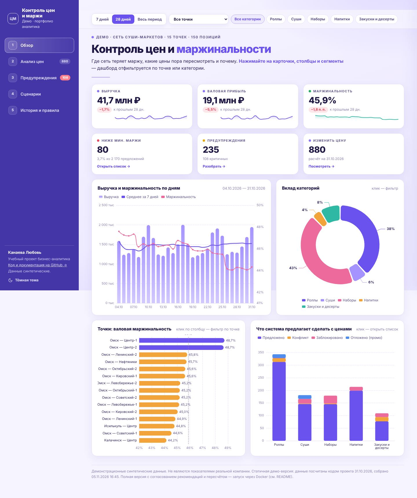 | 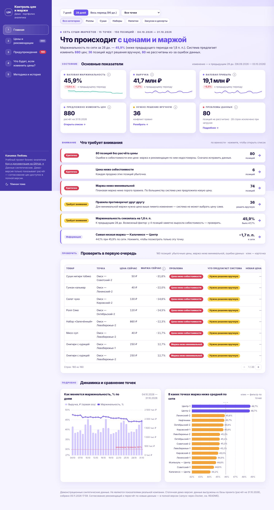 |
| Демо · карточка цены | 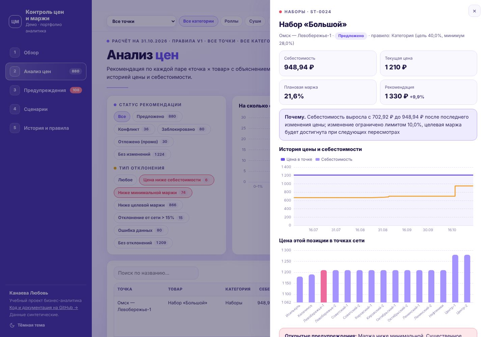 | 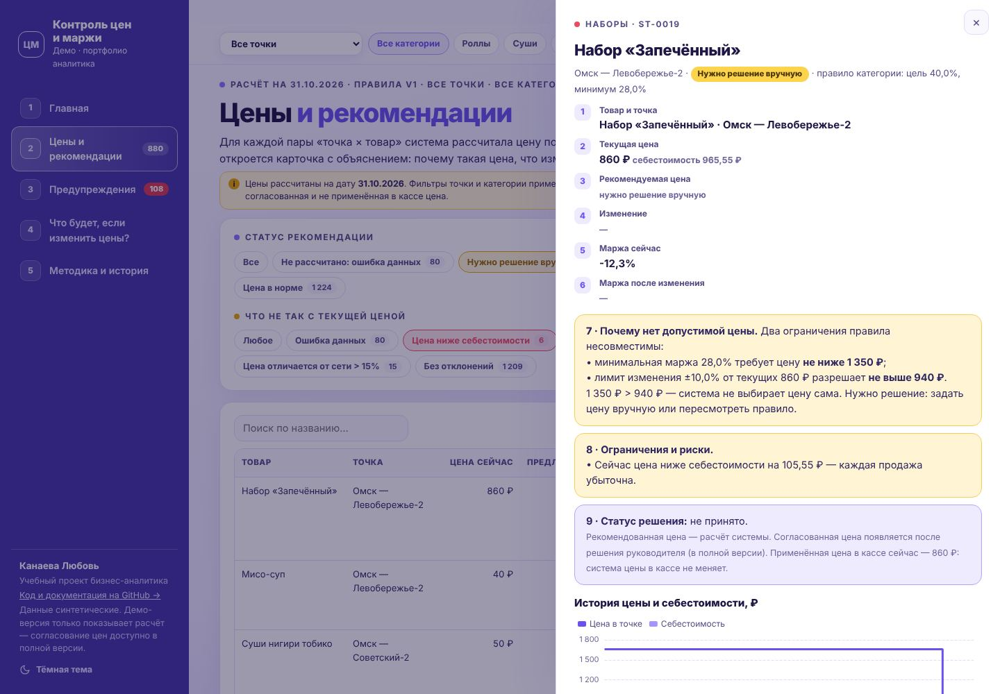 |
| Демо · предупреждения | 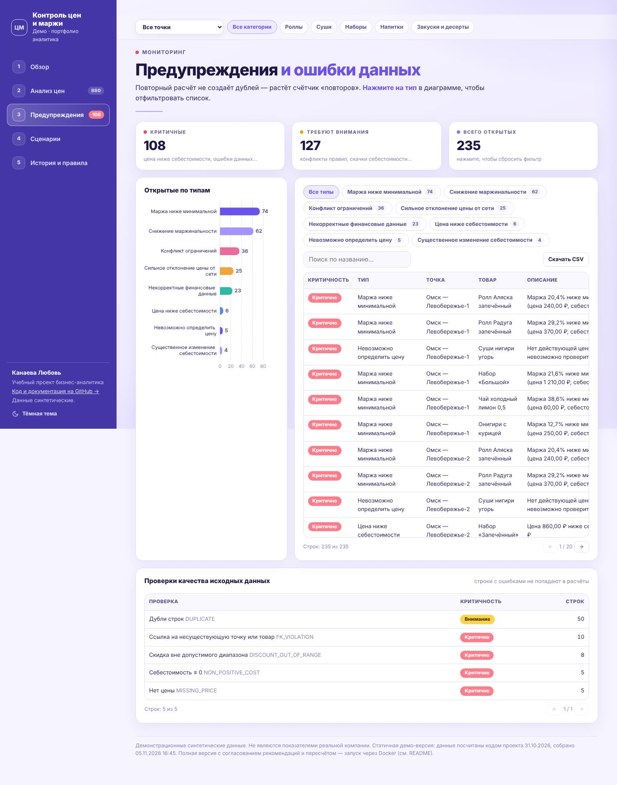 | 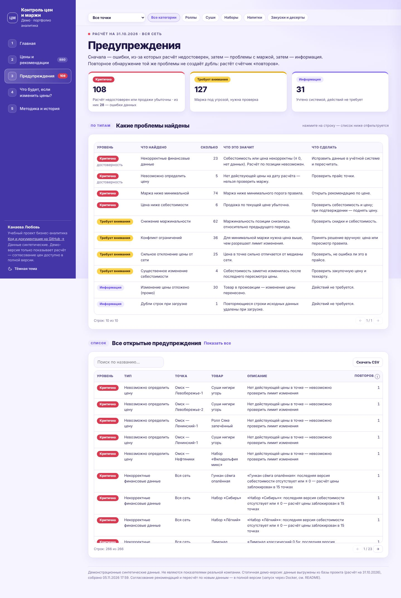 |
| Streamlit · главная | 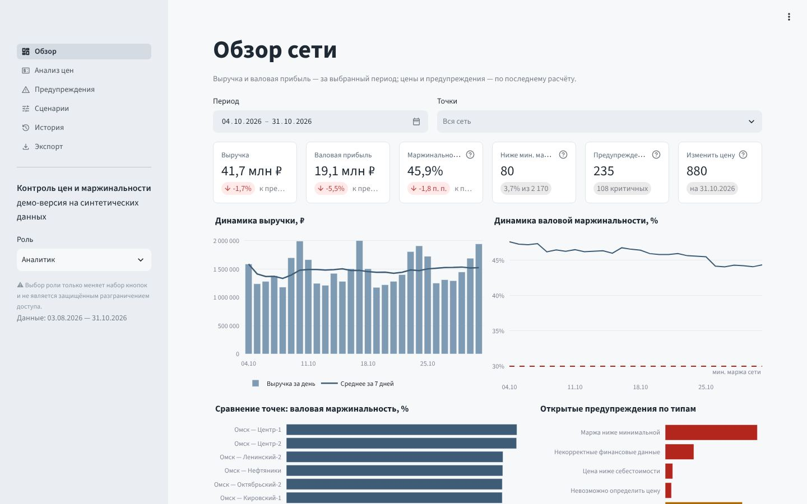 | 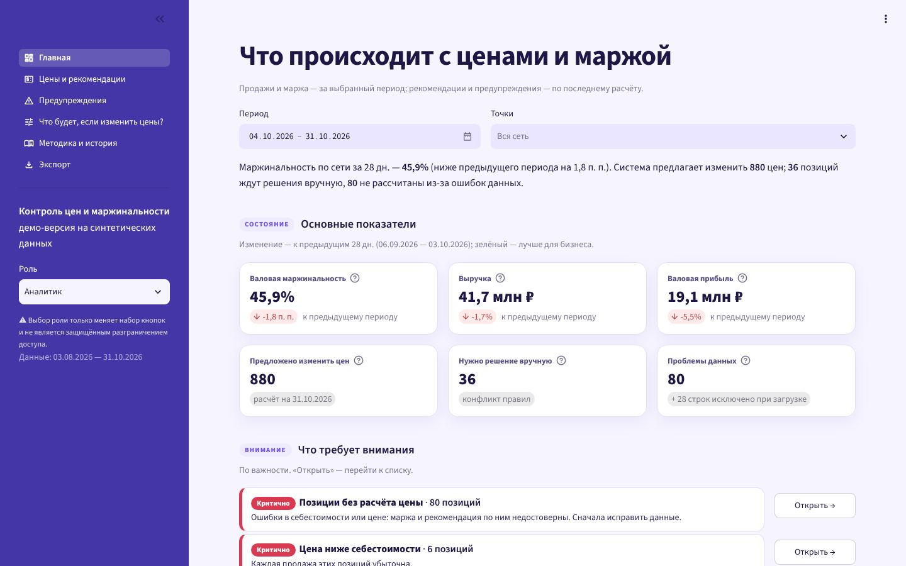 |
| Streamlit · таблица цен | 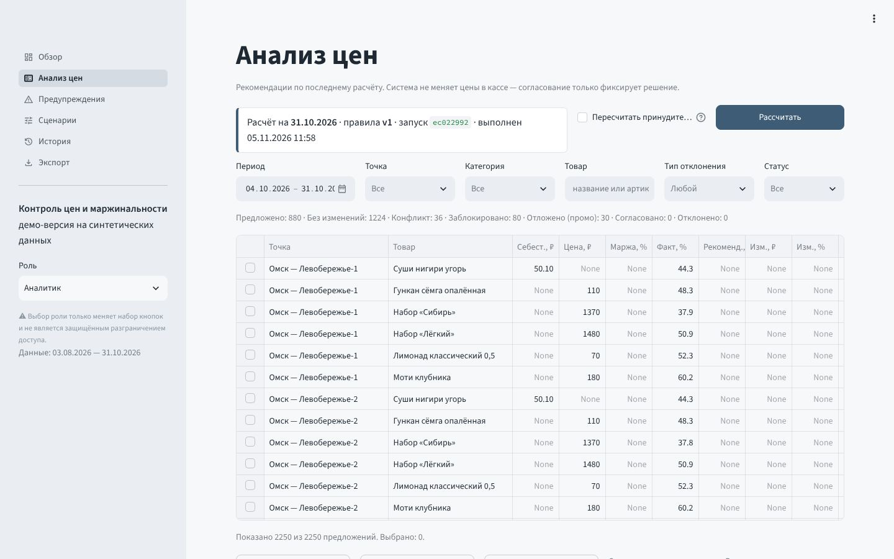 | 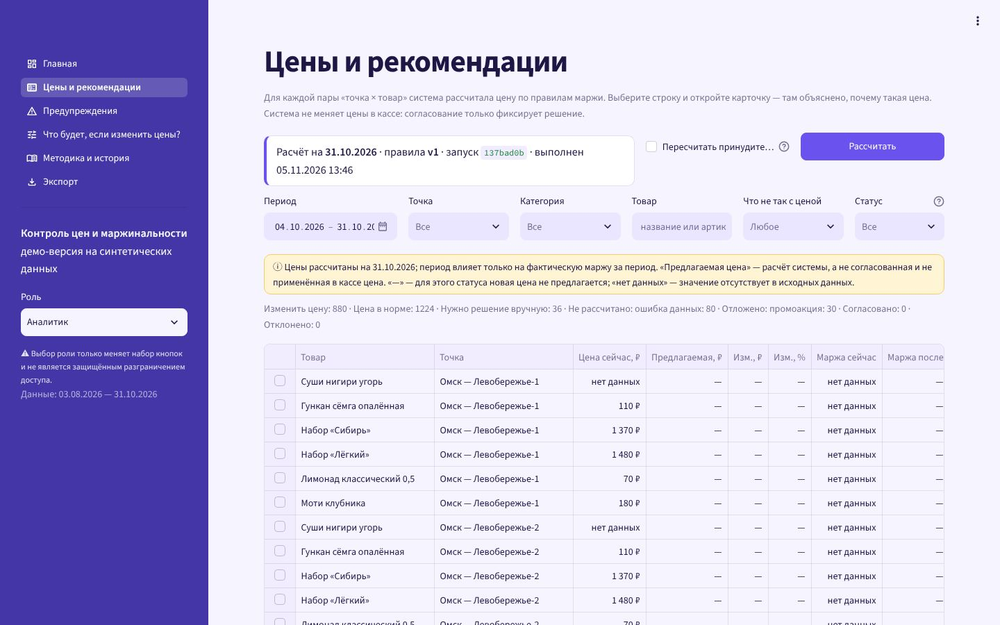 |
| Streamlit · карточка | 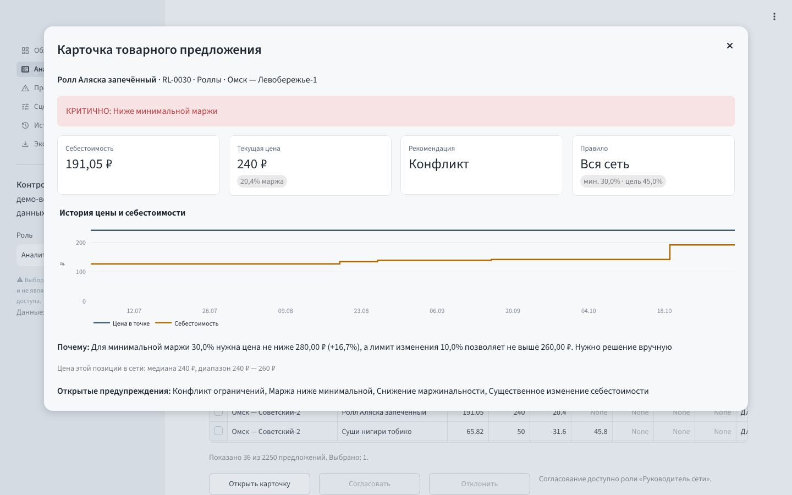 | 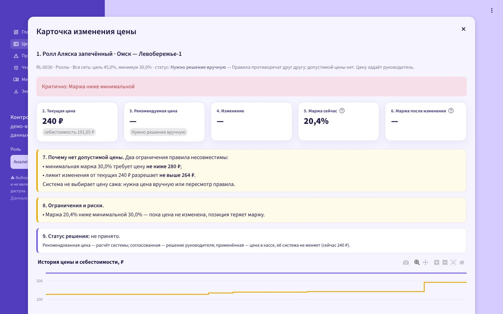 |

Дополнительно «после»: [таблица цен](ux/after_demo_prices.jpg), [«Что будет, если изменить цены?»](ux/after_demo_scenarios.jpg), [телефон 390 px](ux/after_demo_mobile.jpg). Текущие скриншоты полной версии — `docs/screenshots/`.
## 7. Проверка функциональности и расчётов

Все проверки выполнены 05.11.2026 локально (Python 3.12, PostgreSQL 16, Chromium через Playwright).

| Проверка | Результат |
|---|---|
| Автотесты проекта 1 «Продажи, ассортимент и списания» | **84 passed**, покрытие 95% (`docs/test_results.txt`); добавлены тесты: иерархия главной, «нет данных» вместо пустых значений, группы ассортимента |
| Автотесты проекта 2 «Контроль цен и маржинальности» | **104 passed**, покрытие 95%; добавлены тесты: блок «Что требует внимания», «нет данных» в таблице цен; обновлены названия KPI |
| `ruff check`, `ruff format --check` | без замечаний в обоих репозиториях |
| Расчёт цен в браузере (демо проекта 2) против Python | 2 250 из 2 250 рекомендаций совпадают (статус и цена) |
| ABC в браузере (демо проекта 1) против Python | 300 из 300 классов совпадают (выручка и прибыль, 28 дней) |
| Формулы, SQL, пороги правил | не изменялись; новые группы и списки построены на существующих показателях и порогах |
| Сценарии в браузере | клик по блоку внимания → отфильтрованный список; строка → карточка; Esc → возврат фокуса в строку; Enter на строке открывает карточку; фильтр точки → плашка «по всей сети» на ассортименте; тёмная тема; ширина 390 px — без горизонтальной прокрутки; ошибок JavaScript нет |
| Streamlit | все экраны обоих приложений открываются без исключений (AppTest и живой сервер) |

**Сценарии приёмки (§13 ТЗ)** — проверены прохождением по интерфейсу:

1. *Собственник.* Главная: первая фраза — состояние (выручка, маржа, списания с изменением), сразу под KPI — список «Что требует внимания» по важности. ✅
2. *Управляющий.* «Списания: где теряем деньги» → таблица товаров с наибольшими потерями → карточка товара: недельный спрос и задача «что проверить». Фильтр точки работает, а где он не применяется — это написано. ✅
3. *Коммерческий директор.* «Цены и рекомендации» → фильтр «Нужно решение вручную» → карточка: текущая и рекомендуемая цена, маржа до/после, причина, ограничения правила с ценами, риски, статус решения. ✅
4. *Аналитик.* «Методика…»: формулы, ABC/XYZ, правила R1–R5 / алгоритм цены, SQL с текстом запросов, качество данных, журнал; профессиональный режим ассортимента с настройкой порогов (Streamlit). ✅
5. *Новый пользователь.* Разделы названы по задачам, у каждого экрана есть подзаголовок «что здесь и как перейти к деталям», у метрик — подсказки ⓘ. ◐ — проверено автором, без участия реальных пользователей (см. раздел 8).

## 8. Ограничения и что пока не сделано

- **Юзабилити-тестирование с реальными пользователями не проводилось.** Сценарии приёмки проверены автором; время «30 секунд» не измерялось на людях.
- **Демо-версия статичная**: не согласует цены и не пересчитывает по новым данным — это сказано на страницах. Согласование и журнал решений — в полной версии.
- **Демо проекта 1: товарные показатели — по сети.** Продажи по товарам в демо выгружены без разбивки по точкам, поэтому ABC, задачи и таблица товаров не фильтруются по точке (на экране есть плашка). В Streamlit товарная прибыльность фильтруется по точкам.
- **Streamlit: отформатированные колонки — текст.** Чтобы показывать «нет данных» вместо `None`, числа в таблицах выводятся строками в русском формате; сортировка по таким колонкам — по тексту. Точные числовые значения доступны в выгрузке CSV/Excel.
- **Тёмная тема в Streamlit** не настраивалась отдельно (используется встроенная).
- **Полная проверка доступности по WCAG** (скринридеры, все контрасты в тёмной теме) не выполнялась; проверены контраст основных цветов, фокус и управление с клавиатуры.
- **Изменения бизнес-логики не потребовались** и не делались. Единственная правка вне представления — исправление подписи «п. п.» в тексте рекомендаций проекта 1 (была «п, п,»), сделанная до этого этапа.

## 9. Корректировка: устранение информационной перегрузки (06.11.2026)

После первого редизайна экраны всё ещё воспринимались как перегруженные аналитические панели. Поэтому пересмотрена архитектура представления, а не только стили. Расчёты, данные и функции сохранены, меняется только то, где и как они показаны.

Принцип: **главный показатель → понятный вывод → конкретная проблема → подробности по запросу.**

### 9.1. Новая структура: три раздела вместо пяти–шести

| Контроль цен | Продажи и ассортимент |
|---|---|
| **1. Обзор** — вывод одной фразой, 4 показателя, до 3 главных проблем, один график, кнопка следующего шага | **1. Обзор** — то же: вывод, 4 показателя, до 3 проблем, один график, кнопка «Открыть список задач» |
| **2. Рекомендации** — вкладки «Цены к пересмотру» и «Проблемы и ошибки» | **2. Проблемы и рекомендации** — вкладки «Что проверить», «Потери на списаниях», «Низкая маржа» |
| **3. Аналитика** — «Маржа и продажи», «Что будет, если изменить цену?», «Методика и история» (третий уровень) | **3. Аналитика** — «Продажи», «Ассортимент» (группы → профессиональный режим ABC/XYZ), «Списания», «Прибыльность», «Подробные отчёты», «Методика» (третий уровень) |

Методика, правила, история расчётов, SQL и проверки данных больше не стоят в одном ряду с бизнес-разделами. Они находятся в последней вкладке «Аналитики» и открываются отдельной ссылкой внизу меню. В Streamlit меню сгруппировано в те же три раздела с подразделами.

Старые ссылки (`#prices`, `#alerts`, `#scenarios`, `#history`, `#assortment`, `#profit`, `#stock`, `#reports`) продолжают работать: они открывают нужный раздел и вкладку.

### 9.2. Что скрыто, объединено или перенесено

| Было на первом уровне | Стало |
|---|---|
| 6 KPI на обзоре | 4 KPI. Контроль цен: маржа, валовая прибыль, цены к пересмотру, ждут решения (конфликты + ошибки данных). Продажи: выручка, маржа, потери на списаниях, доля списаний. Средний чек и прочие показатели — в «Аналитике» |
| Все найденные проблемы | Не больше 3 на обзоре; остальные — по ссылке «все проблемы» |
| 2–4 графика на обзоре | Один график (маржа по дням / выручка и списания по дням); сравнение точек и категорий — в «Аналитике» |
| Фильтры: период, точка, категория, иногда ещё один | Постоянно видны не больше двух; категория — там, где она нужна, или в «Ещё фильтры» |
| Таблица цен: все статусы сразу, 10 колонок | По умолчанию — «Изменить цену»; товар и точка в одной колонке, цена сейчас → новая, изменение, маржа сейчас → после, краткая причина (полная — в карточке) |
| Распределение изменений цены — график на экране | «Подробнее» в «Аналитике» |
| Задачи — 4 колонки текста в каждой | В строке — важность, товар, проблема, доказательство, что проверить; основание, возможная причина и ограничения — в карточке |
| Списания — 6 KPI и 4 графика | Сверху потери и доля с формулой, таблица товаров с наибольшими потерями; причины, динамика, категории — во вкладке «Списания» «Аналитики» |
| Отчёты SQL — 10 блоков с документацией и исходным SQL | **Каталог «Подробные отчёты»**: название по-русски, какой вопрос решает, 3 главных результата, кнопка «Полная таблица», раскрывающийся «Как считается»; исходный SQL — только внутри «Как считается», свёрнут |
| Цветные метки уровней у каждого заголовка, много рамок | Метки убраны; меньше контейнеров, крупных заголовков и вспомогательных чисел |

Термины в заголовках заменены простыми словами: «Анализ ассортимента», «Что будет, если изменить цену?», «Проблемы и ошибки», «Подробные отчёты». Термины ABC/XYZ, CV, SQL сохранены в пояснениях, профессиональном режиме и методике.

Описания отчётов (название, вопрос, как показывать главные результаты, русские названия колонок) вынесены в `src/asa/report_catalog.py`. Сами расчёты остались в `sql/` и `queries.py`.

### 9.3. Проверка глазами человека без аналитического опыта

Проверено автором по скриншотам всех основных экранов (`docs/ux/v2/`), без участия реальных пользователей.

| Вопрос | Контроль цен | Продажи и ассортимент |
|---|---|---|
| Понятно назначение за 10 секунд? | Да: заголовок «Цены и маржа» (в Streamlit — «Обзор: цены и маржа») и фраза «Маржа сети — 45,9%, на 1,8 п. п. ниже…» | Да: «Продажи и потери», фраза «продано на 41,7 млн ₽, в списание ушло 4,7 млн ₽» |
| Есть один очевидный следующий шаг? | Кнопка «Пересмотреть цены: 880 предложений» | Кнопка «Открыть список задач: 70» |
| Основная проблема понятна без графиков? | Да — первая из трёх карточек проблем | Да — «26 товаров требуют проверки в первую очередь» |
| Показатели не дублируются? | KPI и проблемы не повторяют одно число; общее количество проблем — только в меню и ссылке | Аналогично; маржа — в KPI, средний чек — только в «Аналитике» |
| Нет лишних элементов? | На обзоре 4 KPI, 3 проблемы, 1 график, 1 кнопка | То же |
| Функции и расчёты сохранены? | Да: 2 250 из 2 250 цен совпадают с Python; все экраны Streamlit без ошибок; тесты зелёные | Да: 300 из 300 классов ABC совпадают; каталог показывает все 10 отчётов; тесты зелёные |

**Ограничения корректировки.** Время «10 секунд» на людях не измерялось. В Streamlit вкладки разделов реализованы как подпункты меню: так устроена навигация Streamlit.
